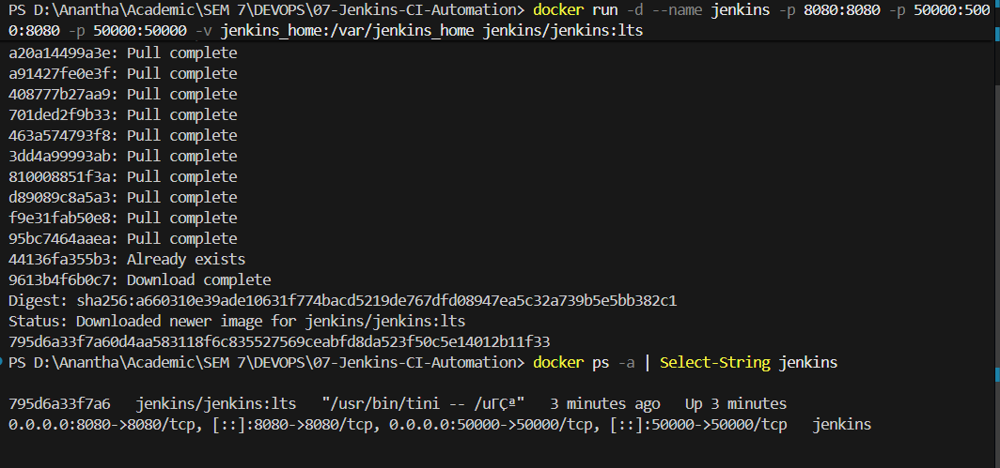
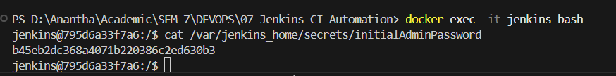
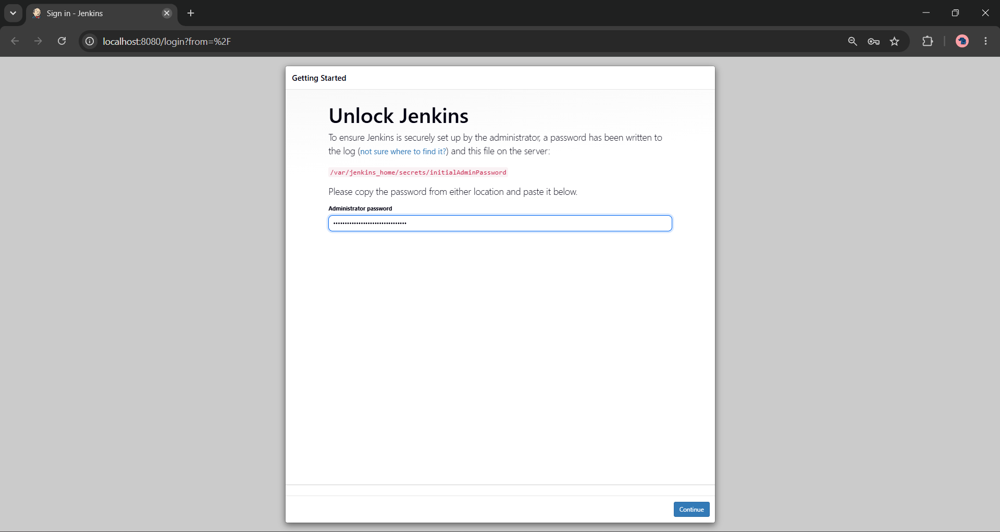
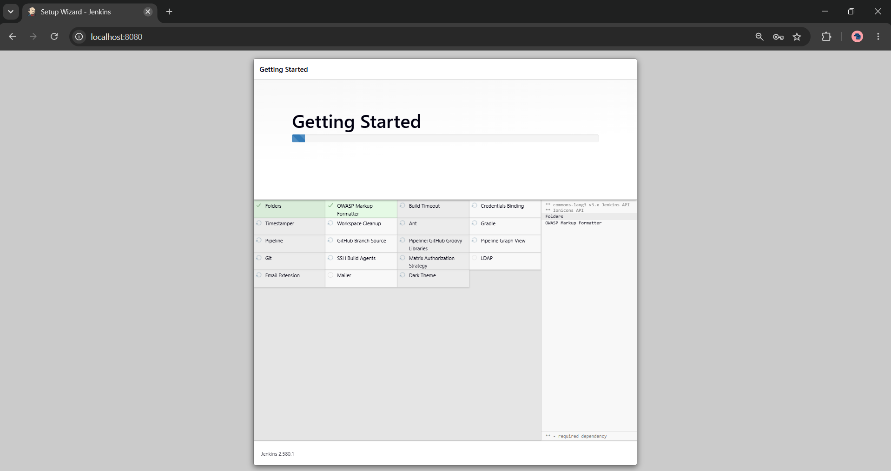
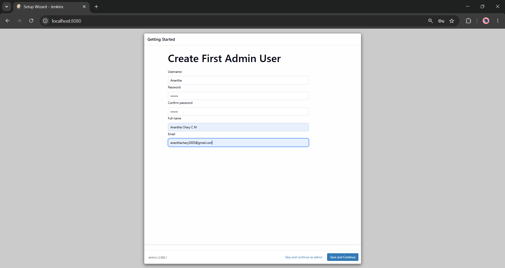

Name: Anantha Chary C M
USN: 1BM23IS025

# Lab 07: Introduction to Continuous Integration (CI) and Jenkins Installation

## Objective

Understand the principles of **Continuous Integration (CI)**, explore popular CI tools, and install **Jenkins** using Docker to set up an automation server for building, testing, and deploying software.

| Component             | Tool               | Purpose                               |
| --------------------- | ------------------ | ------------------------------------- |
| **Container Runtime** | Docker             | Run Jenkins as an isolated container  |
| **CI Server**         | Jenkins (LTS)      | Automation server for CI/CD pipelines |
| **Web Browser**       | Any modern browser | Access the Jenkins dashboard          |

---

## Prerequisites

| Tool                                     | Purpose                       |
| ---------------------------------------- | ----------------------------- |
| **Docker** (Desktop, or Engine in WSL 2) | To run Jenkins as a container |
| **Web browser**                          | To access the Jenkins UI      |

> **Important:** Docker must be **running** before you begin.

---

## Concept: Continuous Integration (CI)

### What is Continuous Integration (CI)?

Continuous Integration (CI) is a development practice where developers frequently integrate their code changes into a shared repository. The primary goal of CI is to detect and address errors early in the development process, improving software quality and accelerating delivery.

### Key Features of CI

1. **Frequent Code Integration** — developers commit code to a shared repository multiple times a day.
2. **Automated Builds** — every commit triggers an automated build to verify the code changes.
3. **Automated Testing** — automated tests run as part of the CI process to ensure functionality remains intact.
4. **Immediate Feedback** — developers receive quick feedback on their changes, allowing them to address issues promptly.

### Benefits of CI

- **Early Bug Detection** — CI helps identify integration issues early, reducing the cost of fixing bugs.
- **Improved Collaboration** — developers work together on the same codebase, ensuring changes are integrated smoothly.
- **Faster Development Cycles** — automated builds and tests speed up the development process.
- **High-Quality Code** — continuous testing ensures code quality and prevents regressions.

### How CI Works

1. **Developer Workflow** — developers write code and push changes to the version control system (e.g., Git).
2. **CI Server Workflow** — the CI server (e.g., Jenkins, GitLab CI) detects the code changes and triggers the build process.
3. **Automated Build** — the codebase is compiled, dependencies are resolved, and the application is built.
4. **Automated Testing** — unit tests, integration tests, and other automated tests are run to verify functionality.
5. **Feedback** — results (success/failure) are communicated back to the developers for further action.

### CI Workflow Example

```
Developer pushes code
        │
        ▼
CI Server detects change
        │
        ▼
Automated Build triggered
        │
        ▼
Automated Tests run
        │
        ▼
Feedback (pass/fail) to developer
```

1. **Code Change** — a developer pushes code to a Git repository.
2. **Trigger Build** — the CI server detects the push and triggers a build.
3. **Run Tests** — automated tests validate the code.
4. **Feedback** — developers receive build and test results.

---

## Examples of CI Tools

| #   | Tool                         | Overview                                                             | Key Features                                                                                | Ideal For                                         | Website                                            |
| --- | ---------------------------- | -------------------------------------------------------------------- | ------------------------------------------------------------------------------------------- | ------------------------------------------------- | -------------------------------------------------- |
| 1   | **GitLab CI/CD**             | Part of GitLab's platform, integrated directly with Git repositories | Built-in with GitLab; YAML pipelines; Auto DevOps                                           | Teams using GitLab for version control            | https://gitlab.com                                 |
| 2   | **CircleCI**                 | Cloud-based CI/CD, easy GitHub/Bitbucket integration                 | Container-based execution; parallelism and caching; native Docker                           | Teams with containerized workflows                | https://circleci.com                               |
| 3   | **Travis CI**                | CI service for open-source and private projects                      | YAML config; many languages supported natively; easy GitHub integration                     | Open-source projects, small teams                 | https://travis-ci.org                              |
| 4   | **Bamboo**                   | Atlassian's CI/CD tool                                               | Build + deployment pipelines; JIRA/Confluence integration; prebuilt deployment environments | Teams in the Atlassian ecosystem                  | https://www.atlassian.com/software/bamboo          |
| 5   | **TeamCity**                 | JetBrains CI/CD server                                               | Detailed build history and reports; prebuilt runners; Docker/Kubernetes plugins             | Complex enterprise CI/CD                          | https://www.jetbrains.com/teamcity                 |
| 6   | **Azure DevOps (Pipelines)** | Microsoft CI/CD as part of its DevOps suite                          | Azure and Visual Studio integration; YAML or classic editor; Windows/macOS/Linux            | Teams on Azure                                    | https://azure.microsoft.com/en-us/services/devops/ |
| 7   | **GitHub Actions**           | GitHub's workflow automation                                         | YAML workflows; large marketplace of actions; deep GitHub integration                       | Teams using GitHub                                | https://github.com/features/actions                |
| 8   | **Spinnaker**                | Open-source continuous delivery and application management           | Multi-cloud deployment; Kubernetes/AWS/GCP integration; canary and blue-green               | Complex cloud deployments                         | https://spinnaker.io                               |
| 9   | **Buildkite**                | Hybrid CI/CD — cloud control plane, self-hosted agents               | Scalable; parallel builds; containerized workflows                                          | Teams with security concerns about fully cloud CI | https://buildkite.com                              |
| 10  | **Drone**                    | Lightweight containerized CI/CD                                      | Docker containers for each pipeline step; GitHub/GitLab/Bitbucket; open-source              | Teams preferring container-based workflows        | https://www.drone.io                               |

---

## Introduction to Jenkins

### What is Jenkins?

Jenkins is an open-source automation server used to build, test, and deploy software. It helps automate parts of the software development process related to building, testing, and deploying, enabling Continuous Integration (CI) and Continuous Delivery (CD).

### Why Use Jenkins?

- **Automation** — automates repetitive tasks.
- **Continuous Integration** — ensures that code changes integrate smoothly.
- **Extensibility** — supports plugins for various tools and services.
- **Scalability** — can run distributed builds on multiple machines.

### Key Jenkins Concepts

1. **Job / Project** — a task or process that Jenkins runs.
2. **Build** — the process of compiling and packaging code.
3. **Pipeline** — a series of steps to build, test, and deploy an application.
4. **Plugins** — extend Jenkins' functionality (e.g., Git plugin, Docker plugin).
5. **Nodes** — machines where Jenkins runs jobs (Master / Agent setup).

---

## Architecture

```
┌──────────────────────────────────────────────────────┐
│                  Jenkins in Docker                    │
│                                                      │
│  ┌─────────────────────────────────────────────┐     │
│  │  Host Machine                                │     │
│  │                                              │     │
│  │  docker run jenkins/jenkins:lts              │     │
│  │       │                                      │     │
│  │       ▼                                      │     │
│  │  ┌──────────────────────────────┐           │     │
│  │  │  Jenkins Container           │           │     │
│  │  │  Port 8080 → Web UI          │           │     │
│  │  │  Port 50000 → Agent JNLP     │           │     │
│  │  │  /var/jenkins_home (volume)   │           │     │
│  │  └──────────────────────────────┘           │     │
│  └─────────────────────────────────────────────┘     │
│                                                      │
│  Browser → http://localhost:8080                      │
└──────────────────────────────────────────────────────┘
```

---

## Step-by-Step Execution

### Step 1: Pull and Run the Jenkins Docker Container

```powershell
docker run -d --name jenkins -p 8080:8080 -p 50000:50000 -v jenkins_home:/var/jenkins_home jenkins/jenkins:lts
```

> **Note:**
>
> - `-p 8080:8080` — Jenkins web UI (external access port is **8080**)
> - `-p 50000:50000` — agent communication port (JNLP)
> - `-v jenkins_home:/var/jenkins_home` — persists Jenkins data in a named volume. Without this, removing the container wipes jobs, plugins, and users

**Expected output:**

```
Unable to find image 'jenkins/jenkins:lts' locally
lts: Pulling from jenkins/jenkins
7d98d813d54f: Pull complete
...
Digest: sha256:7ea4989040ce0840129937b339bf8c8f878c14b08991def312bdf51ca05aa358
Status: Downloaded newer image for jenkins/jenkins:lts
d350facb3a26a8282e286a9f63ea585b93372c97222692cb89429a298e39d1d1
```

Verify the container is running:

```powershell
docker ps -a | Select-String jenkins
```

```
d350facb3a26   jenkins/jenkins:lts   "/usr/bin/tini -- /u…"   Up 14 minutes   0.0.0.0:8080->8080/tcp, 0.0.0.0:50000->50000/tcp   jenkins
```

> 📸 **Screenshot:** `01_jenkins_docker_run.png` — `docker run` + `docker ps` with Jenkins up

---

### Step 2: Retrieve the Initial Admin Password

Enter the container shell:

```powershell
docker exec -it jenkins bash
```

Inside the container, read the password file:

```bash
cat /var/jenkins_home/secrets/initialAdminPassword
exit
```

**Expected output:**

```
fe677853d23642ce9eccc7cf44f3a19d
```

One-liner alternative (without entering the shell):

```powershell
docker exec jenkins cat /var/jenkins_home/secrets/initialAdminPassword
```

> **Important:** The path is `/var/jenkins_home/secrets/initialAdminPassword`. The path `/var/lib/jenkins/secrets/...` applies only to native `apt` package installs, **not** the Docker image.

> 📸 **Screenshot:** `02_initial_password.png` — the `cat` output with the password

---

### Step 3: Access the Jenkins Web UI

Open in a browser:

```
http://localhost:8080/
```

The **"Unlock Jenkins"** page appears. Paste the initial admin password → click **Continue**.

> 📸 **Screenshot:** `03_unlock_jenkins.png` — Unlock Jenkins page

---

### Step 4: Install Suggested Plugins

On the **"Customize Jenkins"** page → click **Install suggested plugins** (takes 2–5 minutes).

> **Note:** This installs essential plugins including Git, Pipeline, Credentials, and others that future labs depend on.

> 📸 **Screenshot:** `04_install_plugins.png` — plugin installation progress

---

### Step 5: Create the First Admin User

| Field     | Value                    |
| --------- | ------------------------ |
| Username  | `admin` (or your choice) |
| Password  | a strong password        |
| Full Name | your name                |
| Email     | your email               |

Click **Save and Continue** → keep the default URL `http://localhost:8080/` on **Instance Configuration** → **Save and Finish** → **Start using Jenkins**.

> 📸 **Screenshot:** `05_create_admin.png` — admin user creation form

---

### Step 6: Explore the Jenkins Dashboard

The Jenkins dashboard shows:

- **New Item** — create jobs / pipelines
- **Manage Jenkins** — system settings, plugins, security, nodes
- **Build Queue** — queued builds
- **Build Executor Status** — running builds

> 📸 **Screenshot:** `06_jenkins_dashboard.png` — Jenkins landing page

---

## Deployment Evidence

### Docker Run & Container Status



### Initial Admin Password



### Unlock Jenkins



### Plugin Installation



### Admin User Creation



### Jenkins Dashboard


---

## Verification Summary

| Item                  | Expected Value                                             |
| --------------------- | ---------------------------------------------------------- |
| **Jenkins Container** | Running, ports `8080` and `50000` published                |
| **Persistence**       | `jenkins_home` volume attached                             |
| **Jenkins URL**       | `http://localhost:8080`                                    |
| **Initial Password**  | Read from `/var/jenkins_home/secrets/initialAdminPassword` |
| **Plugins**           | Suggested plugins installed                                |
| **Admin User**        | Created                                                    |
| **Dashboard**         | Accessible                                                 |

---

## Cleanup (after submission)

```powershell
docker stop jenkins
docker rm jenkins

# Optional — this deletes ALL Jenkins data (jobs, users, plugins)
docker volume rm jenkins_home

docker ps -a
```

> **Important:** Labs 08 and 09 need this Jenkins instance. Don't remove the volume until all three labs are submitted — `docker start jenkins` brings it back.

---

## Troubleshooting

| Problem                                       | Solution                                                                 |
| --------------------------------------------- | ------------------------------------------------------------------------ |
| `docker run` fails                            | Is Docker running? Is port 8080 free?                                    |
| Can't find the initial password               | `docker exec jenkins cat /var/jenkins_home/secrets/initialAdminPassword` |
| Page not loading                              | Jenkins needs 30–60s to boot. Check `docker logs jenkins`                |
| Plugin installation fails                     | Check internet connectivity, then **Retry** in the UI                    |
| Port 8080 in use                              | Use `-p 9090:8080` instead → open `http://localhost:9090`                |
| Container exited; data gone after `docker rm` | Volume was missing. Always run with `-v jenkins_home:/var/jenkins_home`  |

---

## Quick Reference: Complete Command Sequence

```powershell
# Step 1: run Jenkins
docker run -d --name jenkins -p 8080:8080 -p 50000:50000 -v jenkins_home:/var/jenkins_home jenkins/jenkins:lts
docker ps -a | Select-String jenkins
# 📸 01_jenkins_docker_run.png

# Step 2: initial admin password
docker exec -it jenkins bash
# cat /var/jenkins_home/secrets/initialAdminPassword
# exit
# 📸 02_initial_password.png

# Step 3: http://localhost:8080 → paste password
# 📸 03_unlock_jenkins.png

# Step 4: install suggested plugins
# 📸 04_install_plugins.png

# Step 5: create admin user
# 📸 05_create_admin.png

# Step 6: dashboard
# 📸 06_jenkins_dashboard.png
```

---
