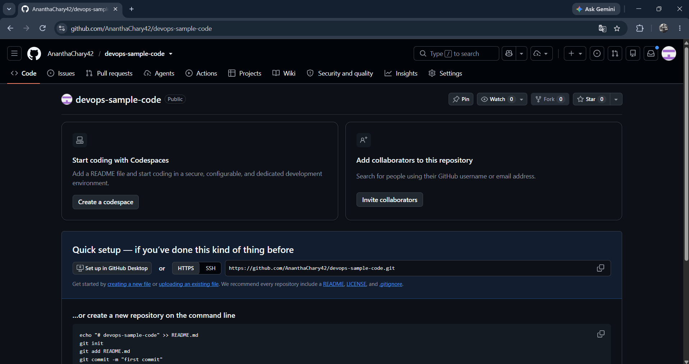
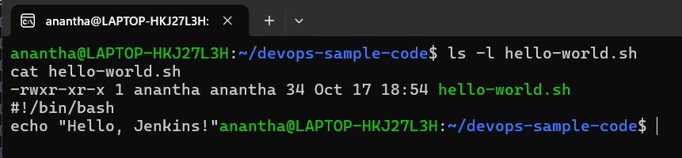
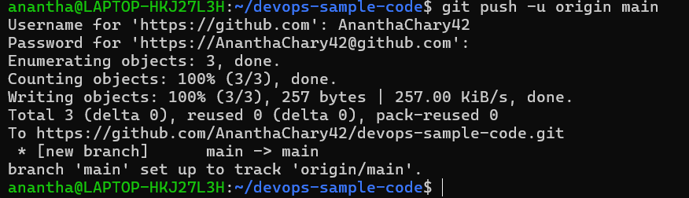
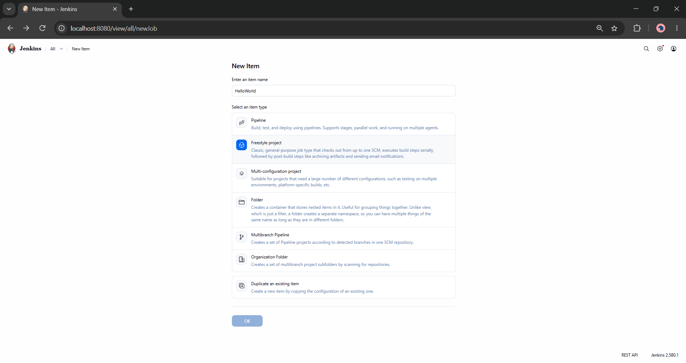
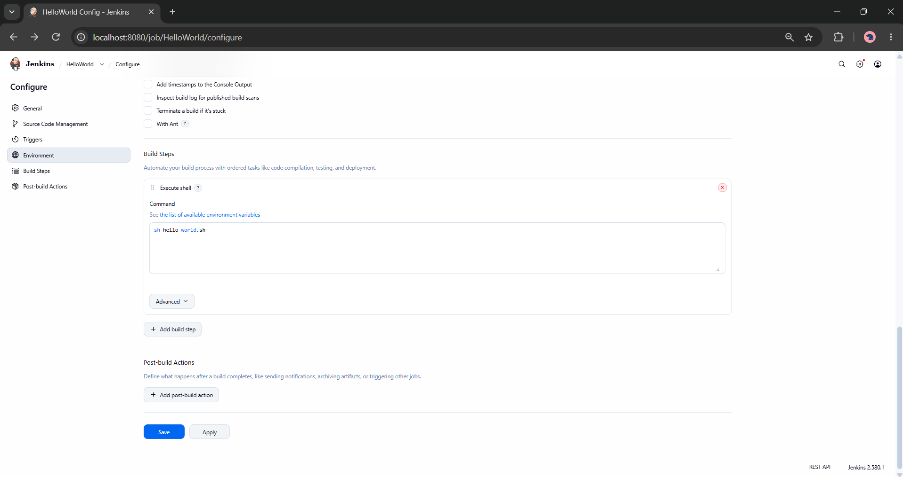
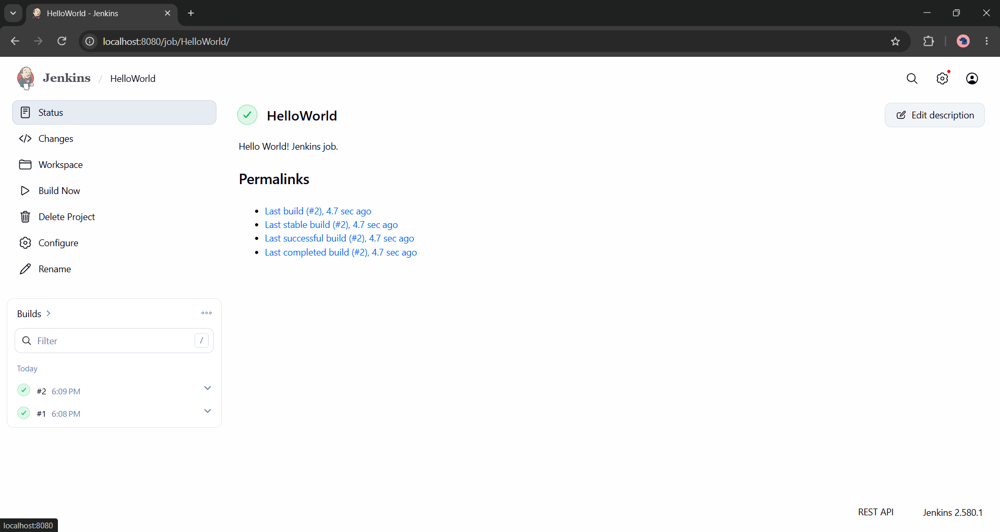
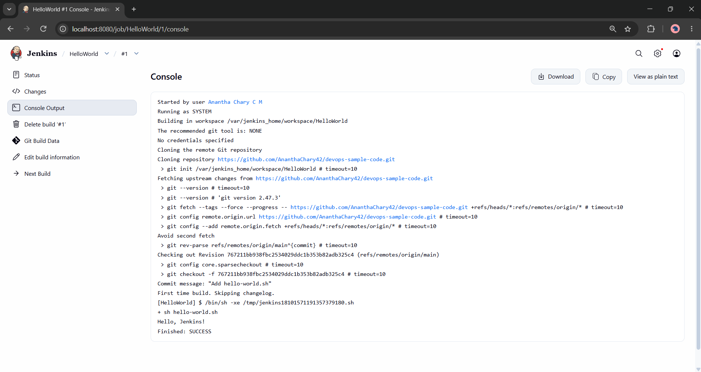

Name: Anantha Chary C M
USN: 1BM23IS025

# Lab 08: Creating a "Hello World" Jenkins Job

## Objective

Create your first Jenkins **Freestyle job** that:

1. Pulls a shell script (`hello-world.sh`) from a **GitHub repository**
2. Executes the script as a **build step**
3. Displays the output in **Console Output**

| Component           | Tool           | Purpose                                   |
| ------------------- | -------------- | ----------------------------------------- |
| **CI Server**       | Jenkins (LTS)  | Run the Freestyle build job               |
| **Version Control** | GitHub         | Host the `hello-world.sh` script          |
| **SCM Plugin**      | Git (Jenkins)  | Clone the repo into the Jenkins workspace |
| **Shell**           | Git Bash / WSL | Create the script and push to GitHub      |

---

## Prerequisites

| Tool               | Purpose                                     |
| ------------------ | ------------------------------------------- |
| **Jenkins**        | Running at `http://localhost:8080` (Lab 07) |
| **GitHub account** | To host the script repository               |
| **Git**            | Installed locally                           |

> **Important:** Jenkins must be running: `docker start jenkins` if it is stopped.

---

## Architecture

```
┌────────────────────────────────────────────────────────────┐
│                     Lab 08 Workflow                         │
│                                                            │
│  ┌──────────┐    git push     ┌──────────────────┐        │
│  │  Local    │ ──────────────►│  GitHub           │        │
│  │  Machine  │                │  devops-sample-   │        │
│  │           │                │  code repo        │        │
│  └──────────┘                └────────┬─────────┘        │
│                                        │                   │
│                                  git clone                 │
│                                        │                   │
│                                        ▼                   │
│                               ┌──────────────────┐        │
│                               │  Jenkins          │        │
│                               │  (Docker)         │        │
│                               │                   │        │
│                               │  HelloWorld job   │        │
│                               │  → sh hello-      │        │
│                               │    world.sh       │        │
│                               │  → "Hello,        │        │
│                               │     Jenkins!"     │        │
│                               └──────────────────┘        │
└────────────────────────────────────────────────────────────┘
```

---

## Part A: Prepare the GitHub Repository

### Step 1: Create a New GitHub Repository

1. Log in to [github.com](https://www.github.com)
2. Click **+** (top-right) → **New Repository**
3. Fill in:

| Field               | Value                                   |
| ------------------- | --------------------------------------- |
| **Repository Name** | `devops-sample-code`                    |
| **Description**     | A demo repository for Jenkins scripting |
| **Visibility**      | **Public**                              |

4. Click **Create Repository**

> 📸 **Screenshot:** `01_github_repo.png` — the new repository page

---

### Step 2: Create a Fine-Grained Personal Access Token (PAT)

1. **GitHub → Settings → Developer Settings → Personal access tokens → Fine-grained tokens**
2. **Generate new token**, name it (e.g. `z`)
3. **Repository access** → select `devops-sample-code` → **Permissions → Contents: Read and write**
4. **Generate token** and copy it — it is shown only once

Reference: https://docs.github.com/en/authentication/keeping-your-account-and-data-secure/managing-your-personal-access-tokens#creating-a-fine-grained-personal-access-token

> **Important:** The PAT replaces your password for `git push`. Save it somewhere safe.

---

### Step 3: Create the Script Locally and Make It Executable

```bash
mkdir devops-sample-code
cd devops-sample-code
touch hello-world.sh
```

Edit `hello-world.sh` (vim, VS Code, or Notepad):

```bash
#!/bin/bash
echo "Hello, Jenkins!"
```

Make it executable:

```bash
chmod +x hello-world.sh
```

> **Note:** On Windows, run these in **WSL** or **Git Bash** so the execute bit is actually recorded in Git. From PowerShell the mode bit is not set; if you must use PowerShell, add `git update-index --chmod=+x hello-world.sh` before committing.

Verify:

```bash
ls -l hello-world.sh
cat hello-world.sh
```

> 📸 **Screenshot:** `02_hello_world_sh.png` — file content and `ls -l` showing the `x` bit

---

### Step 4: Configure Git and Initialize the Repository

First time on this machine:

```bash
git config --global user.name "Your Name"
git config --global user.email "your-email@example.com"
```

Initialize:

```bash
git init
```

---

### Step 5: Add and Commit the Script

```bash
git add hello-world.sh
git status
```

**Expected output:**

```
On branch master

No commits yet

Changes to be committed:
  (use "git rm --cached <file>..." to unstage)
        new file:   hello-world.sh
```

Commit:

```bash
git commit -m "Add hello-world.sh"
```

**Expected output:**

```
[master (root-commit) 2e1b718] Add hello-world.sh
 1 file changed, 2 insertions(+)
 create mode 100755 hello-world.sh
```

---

### Step 6: Link to GitHub and Push

Rename the branch to `main` first — GitHub creates `main` by default, but `git init` creates `master`, so pushing `main` from a `master` checkout fails:

```bash
git branch -M main
git remote add origin https://github.com/<your-GitHub-username>/devops-sample-code.git
git push -u origin main
```

When prompted:

- **Username:** your GitHub username
- **Password:** paste the **PAT** from Step 2 (not your GitHub password)

**Expected output:**

```
Enumerating objects: 3, done.
Counting objects: 100% (3/3), done.
Writing objects: 100% (3/3), 306 bytes | 306.00 KiB/s, done.
To https://github.com/<your-username>/devops-sample-code.git
 * [new branch]      main -> main
branch 'main' set up to track 'origin/main'.
```

---

### Step 7: Verify the Script on GitHub

Open `https://github.com/<your-username>/devops-sample-code` and confirm `hello-world.sh` is there with the expected content.

> 📸 **Screenshot:** `03_git_push.png` — `git push` output and the file on GitHub

---

## Part B: Create the Jenkins Job

### Step 8: Access Jenkins

1. Open `http://localhost:8080`
2. Log in with the admin credentials from Lab 07

---

### Step 9: Create a New Freestyle Job

1. Click **New Item** (left menu)
2. Name: `HelloWorld`
3. Select **Freestyle project**
4. Click **OK**

> 📸 **Screenshot:** `04_new_item.png` — New Item page with `HelloWorld` + Freestyle project

---

### Step 10: Configure the Job

**General**

Description:

```
Hello World! Jenkins job.
```

**Source Code Management**

1. Select **Git**
2. **Repository URL:** `https://github.com/<your-username>/devops-sample-code.git`
3. **Credentials:** none needed for a public repo; for a private one add _Username + PAT_ as a Username/Password credential
4. **Branch Specifier:** `*/main`

> **Important:** Jenkins defaults to `*/master`. Leaving it means the checkout finds nothing and the build fails with _Couldn't find any revision to build_.

**Build Steps**

**Add build step → Execute shell:**

```bash
sh hello-world.sh
```

Click **Save**.

> 📸 **Screenshot:** `05_job_config.png` — Git URL, branch specifier, and the Execute shell step

---

### Step 11: Run the Job

Click **Build Now**. A build appears in **Build History**.

> 📸 **Screenshot:** `06_build_now.png` — Build Now and the build in history

---

### Step 12: View the Build Output

Build **#1** → **Console Output**.

**Expected output:**

```
Started by user Admin
Building in workspace /var/jenkins_home/workspace/HelloWorld
 > git fetch --tags --force --progress -- https://github.com/<your-username>/devops-sample-code.git +refs/heads/*:refs/remotes/origin/*
 > git checkout -f <commit-sha>
[HelloWorld] $ /bin/sh -xe /tmp/jenkins1281930102.sh
+ sh hello-world.sh
Hello, Jenkins!
Finished: SUCCESS
```

> **Important:** The key line is `Hello, Jenkins!` — it proves the script was pulled from GitHub and executed. `+ sh hello-world.sh` is the echoed build step (`/bin/sh -xe` traces each command).

> 📸 **Screenshot:** `07_console_output.png` — Console Output with `Hello, Jenkins!` and `Finished: SUCCESS`

---

## Deployment Evidence

### GitHub Repository



### Script File



### Git Push



### New Item



### Job Configuration



### Build Now



### Console Output



---

## Verification Summary

| Item                   | Expected Value                                            |
| ---------------------- | --------------------------------------------------------- |
| **GitHub Repository**  | `devops-sample-code`, public, containing `hello-world.sh` |
| **Script Permissions** | Executable (`chmod +x`, mode `100755`)                    |
| **Git Identity**       | `user.name` and `user.email` configured                   |
| **Branch**             | `main`, tracking `origin/main`                            |
| **Jenkins Job**        | `HelloWorld`, Freestyle project                           |
| **SCM**                | Git → repo URL, Branch Specifier `*/main`                 |
| **Build Step**         | Execute shell: `sh hello-world.sh`                        |
| **Console Output**     | `Hello, Jenkins!`                                         |
| **Build Status**       | `Finished: SUCCESS`                                       |

---

## Cleanup (after submission)

```bash
# In the Jenkins UI: HelloWorld job → left menu → Delete Project

# Optional — Lab 09 reuses this Jenkins instance, so prefer leaving it up
docker stop jenkins
```

> **Note:** Keep the `devops-sample-code` repository — Lab 09 pushes the Flask app and Jenkinsfile to it.

---

## Troubleshooting

| Problem                                    | Solution                                                                                                                                                              |
| ------------------------------------------ | --------------------------------------------------------------------------------------------------------------------------------------------------------------------- |
| `src refspec main does not match any`      | You are on `master`. Run `git branch -M main`, then push                                                                                                              |
| `git push` asks for a password and rejects | Use the **PAT** as the password, not your GitHub password                                                                                                             |
| `Couldn't find any revision to build`      | Branch Specifier is `*/master` — change it to `*/main`                                                                                                                |
| Jenkins can't clone the repo               | URL correct? Repo public? If private, add Username+PAT credentials in the job                                                                                         |
| Build: `permission denied`                 | Execute bit lost on push. Run `git update-index --chmod=+x hello-world.sh` and re-push, or add `chmod +x hello-world.sh` before `sh hello-world.sh` in the build step |
| "Git" missing under SCM                    | **Manage Jenkins → Plugins → Available** → install **Git**                                                                                                            |
| `Finished: FAILURE`                        | Open Console Output — usually wrong branch or wrong script path                                                                                                       |
| Empty commit author error                  | `git config --global user.name/user.email` not set — Step 4                                                                                                           |

---

## Quick Reference: Complete Command Sequence

```bash
# Part A: GitHub repo (run in WSL or Git Bash)
mkdir devops-sample-code && cd devops-sample-code
touch hello-world.sh
# content: #!/bin/bash   /   echo "Hello, Jenkins!"
chmod +x hello-world.sh
# 📸 01_github_repo.png
# 📸 02_hello_world_sh.png

git config --global user.name "Your Name"
git config --global user.email "your-email@example.com"
git init
git add hello-world.sh
git status
git commit -m "Add hello-world.sh"
git branch -M main
git remote add origin https://github.com/<your-username>/devops-sample-code.git
git push -u origin main      # password = PAT
# 📸 03_git_push.png

# Part B: Jenkins job at http://localhost:8080
# New Item → "HelloWorld" → Freestyle project
# 📸 04_new_item.png
# SCM → Git → repo URL → Branch Specifier */main
# Build step → Execute shell → sh hello-world.sh
# 📸 05_job_config.png
# Build Now
# 📸 06_build_now.png
# Console Output → "Hello, Jenkins!" + "Finished: SUCCESS"
# 📸 07_console_output.png
```
