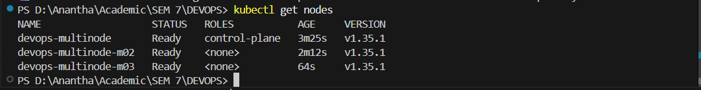
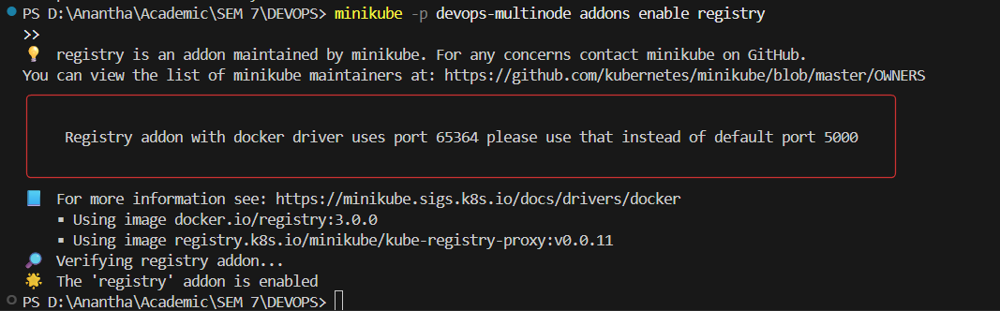
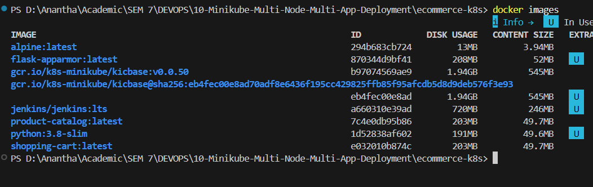
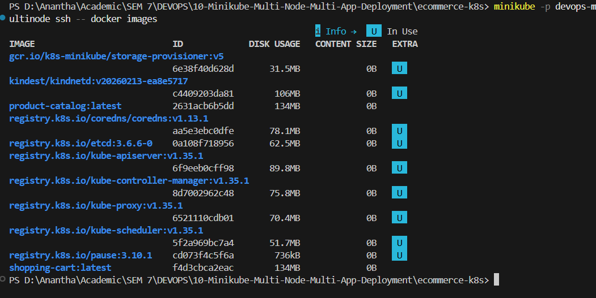
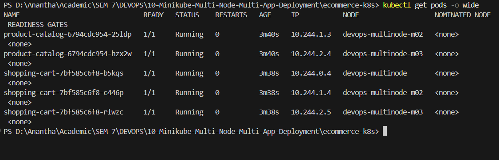
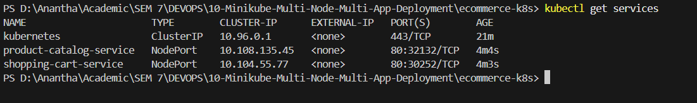
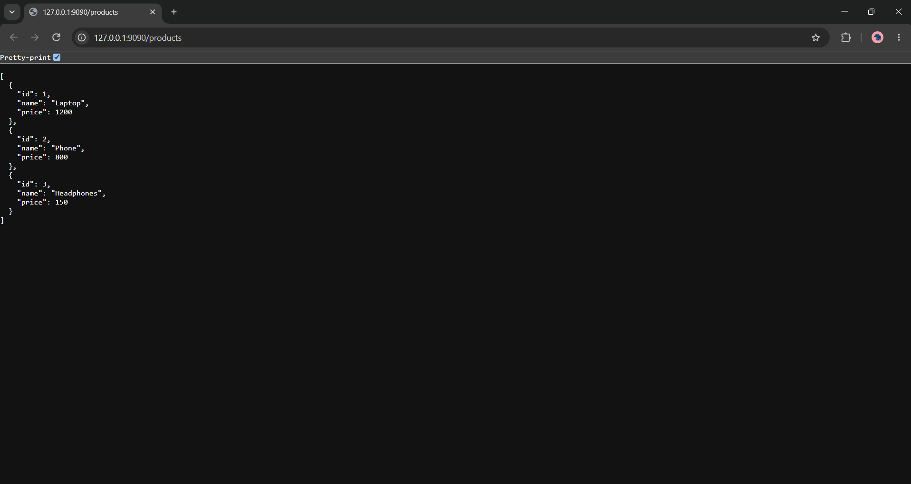
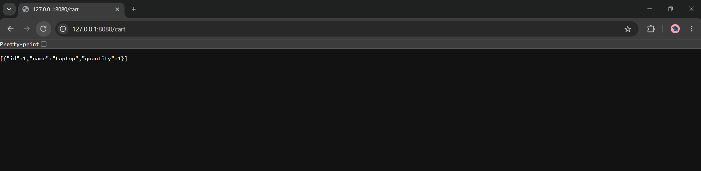

Name: Anantha Chary C M
USN: 1BM23IS025

# Lab 10: Multi-Node Kubernetes Cluster with Multiple Applications and ReplicaSets

## Storyboard

An e-commerce platform with two microservices:

1. **Product Catalog (AppA)** — provides information about available products
2. **Shopping Cart (AppB)** — manages user shopping carts

For availability and fault tolerance, the Product Catalog runs **2 replicas** and the Shopping Cart **3 replicas**, each distributed across different nodes to handle traffic and provide redundancy.

## Use Case

An online store needs high availability for critical services like product browsing and cart management. Deploying each service with replicas spread across multiple nodes ensures that even if one node fails, the services remain available to customers.

---

## Objective

| Application | Service         | Replicas | Purpose                      |
| ----------- | --------------- | -------- | ---------------------------- |
| **AppA**    | Product Catalog | 2        | Lists available products     |
| **AppB**    | Shopping Cart   | 3        | Manages user shopping carts  |

**Key concepts:** multi-node cluster, Pod Anti-Affinity, ReplicaSets, fault tolerance, NodePort Services.

---

## Prerequisites

| Tool          | Purpose                           |
| ------------- | --------------------------------- |
| **Docker**    | Container runtime / Minikube driver |
| **Minikube**  | Local Kubernetes cluster          |
| **kubectl**   | Kubernetes CLI                    |
| **Python 3.x**| To write the Flask applications   |

> **Important:** A **3-node** cluster needs more resources than earlier labs — allow Docker at least **4 GB** memory (Docker Desktop → Settings → Resources).

---

## Architecture

```
┌────────────────────────────────────────────────────────────────────────┐
│               Lab 10 Multi-Node Deployment                             │
│                                                                        │
│  ┌──────────────────────────────────────────────────────────────────┐  │
│  │            Minikube Cluster (devops-multinode)                    │  │
│  │                                                                  │  │
│  │  ┌──────────────────┐  ┌─────────────────┐  ┌────────────────┐  │  │
│  │  │ devops-multinode  │  │ devops-multinode │  │ devops-multi-  │  │  │
│  │  │ (control-plane)   │  │      -m02        │  │   node-m03     │  │  │
│  │  │                   │  │                  │  │                │  │  │
│  │  │ ┌───────────────┐ │  │ ┌──────────────┐│  │ ┌────────────┐│  │  │
│  │  │ │ shopping-cart  │ │  │ │product-catalog││  │ │product-    ││  │  │
│  │  │ │ (replica 1)   │ │  │ │(replica 1)   ││  │ │catalog     ││  │  │
│  │  │ └───────────────┘ │  │ ├──────────────┤│  │ │(replica 2) ││  │  │
│  │  │                   │  │ │shopping-cart  ││  │ ├────────────┤│  │  │
│  │  │                   │  │ │(replica 2)   ││  │ │shopping-   ││  │  │
│  │  │                   │  │ └──────────────┘│  │ │cart         ││  │  │
│  │  │                   │  │                  │  │ │(replica 3) ││  │  │
│  │  │                   │  │                  │  │ └────────────┘│  │  │
│  │  └──────────────────┘  └─────────────────┘  └────────────────┘  │  │
│  └──────────────────────────────────────────────────────────────────┘  │
│                                                                        │
│  Pod Anti-Affinity ensures no two pods of the same app share a node    │
└────────────────────────────────────────────────────────────────────────┘
```

---

## Part A: Set Up the Multi-Node Cluster

### Step 1: Clean Up Any Existing Minikube Cluster

```bash
minikube stop
minikube delete
```

> **Note:** Skip if no cluster is running.

---

### Step 2: Start a Multi-Node Minikube Cluster

```bash
minikube start --nodes 3 -p devops-multinode --driver=docker
```

> **Note:**
>
> - `--nodes 3` → 1 control-plane + 2 workers
> - `-p devops-multinode` → profile name, needed in every later `minikube` command
> - Takes **3–5 minutes**
> - **Running as root?** The docker driver refuses root for host-security reasons. Add `--force` to override:
>   ```bash
>   minikube start --nodes 3 -p devops-multinode --force
>   ```

Verify all nodes are ready:

```bash
kubectl get nodes
```

**Expected output:**

```
NAME                   STATUS   ROLES           AGE   VERSION
devops-multinode       Ready    control-plane   Xm    v1.31.0
devops-multinode-m02   Ready    <none>          Xm    v1.31.0
devops-multinode-m03   Ready    <none>          Xm    v1.31.0
```

> **Important:** Wait until all 3 nodes are `Ready`.

> 📸 **Screenshot:** `01_multinode_start.png` — `minikube start --nodes 3` output + 3 Ready nodes

---

### Step 3: Enable the Minikube Registry Add-on

A multi-node cluster cannot use `eval $(minikube -p devops-multinode docker-env)` to share local images — the registry add-on (plus `image load`) distributes them instead.

```bash
minikube -p devops-multinode addons enable registry
```

**Expected output:**

```
💡  registry is an addon maintained by minikube. For any concerns contact minikube on GitHub.
╭──────────────────────────────────────────────────────────────────────────────────────────────────────╮
│    Registry addon with docker driver uses port 32775 please use that instead of default port 5000    │
╰──────────────────────────────────────────────────────────────────────────────────────────────────────╯
    ▪ Using image gcr.io/k8s-minikube/kube-registry-proxy:0.0.6
    ▪ Using image docker.io/registry:2.8.3
🔎  Verifying registry addon...
🌟  The 'registry' addon is enabled
```

> **Note:** With the docker driver the registry is reachable on **port 32775**, not the default 5000. This lab pushes images with `minikube image load` (Step 8), so the port only matters if you tag and push to the registry directly.

> 📸 **Screenshot:** `02_registry_addon.png` — registry add-on enabled

---

## Part B: Create the Application Source Files

### Step 4: Product Catalog Application (AppA)

Create `product_catalog.py` — a Flask application providing an endpoint to list available products:

```python
# product_catalog.py
from flask import Flask, jsonify

app = Flask(__name__)

products = [
    {"id": 1, "name": "Laptop", "price": 1200},
    {"id": 2, "name": "Phone", "price": 800},
    {"id": 3, "name": "Headphones", "price": 150},
]

@app.route("/products", methods=["GET"])
def get_products():
    return jsonify(products)

if __name__ == "__main__":
    app.run(host="0.0.0.0", port=80)
```


---

### Step 5: Shopping Cart Application (AppB)

Create `shopping_cart.py` — a Flask application providing endpoints to view and add items to the shopping cart:

```python
# shopping_cart.py
from flask import Flask, jsonify, request

app = Flask(__name__)

cart = []

@app.route("/cart", methods=["GET"])
def get_cart():
    return jsonify(cart)

@app.route("/cart", methods=["POST"])
def add_to_cart():
    item = request.json
    cart.append(item)
    return jsonify(cart), 201

if __name__ == "__main__":
    app.run(host="0.0.0.0", port=80)
```

> **Note:** The cart is an in-memory list per pod, so a GET may hit a different replica than the POST did and come back empty. That is expected for this exercise — it is exactly why real services use shared state (a database or cache).


---

## Part C: Dockerize and Load Images

### Step 6: Create the Dockerfiles

**Product Catalog Dockerfile** — save as `Dockerfile.product`:

```dockerfile
# Dockerfile for Product Catalog
FROM python:3.9-slim
WORKDIR /app
COPY product_catalog.py /app/
RUN pip install flask
CMD ["python", "product_catalog.py"]
```

**Shopping Cart Dockerfile** — save as `Dockerfile.shopping`:

```dockerfile
# Dockerfile for Shopping Cart
FROM python:3.9-slim
WORKDIR /app
COPY shopping_cart.py /app/
RUN pip install flask
CMD ["python", "shopping_cart.py"]
```


---

### Step 7: Build the Docker Images

```bash
docker build -t product-catalog:latest -f Dockerfile.product .
docker build -t shopping-cart:latest -f Dockerfile.shopping .
docker images
```

**Expected output:**

```
REPOSITORY        TAG      IMAGE ID       CREATED          SIZE
shopping-cart     latest   cdfedc6f31ff   8 seconds ago    137MB
product-catalog   latest   2e47c49941d7   53 seconds ago   137MB
```

> 📸 **Screenshot:** `03_docker_build.png` — both builds + `docker images`

---

### Step 8: Load the Images into Minikube

```bash
minikube -p devops-multinode image load product-catalog:latest
minikube -p devops-multinode image load shopping-cart:latest
```

> **Note:** This copies each image to **every node** in the profile — roughly a minute per image.

Verify the images are loaded:

```bash
minikube -p devops-multinode ssh -- docker images
```

**Expected output:** both `product-catalog` and `shopping-cart` listed alongside the `registry.k8s.io/*` system images:

```
REPOSITORY                                TAG                  IMAGE ID       CREATED          SIZE
shopping-cart                             latest               cdfedc6f31ff   17 minutes ago   137MB
product-catalog                           latest               2e47c49941d7   18 minutes ago   137MB
kindest/kindnetd                          v20240813-c6f155d6   12968670680f   3 months ago     85.8MB
registry.k8s.io/kube-scheduler            v1.31.0              1766f54c897f   3 months ago     67.4MB
registry.k8s.io/kube-controller-manager   v1.31.0              045733566833   3 months ago     88.4MB
registry.k8s.io/kube-apiserver            v1.31.0              604f5db92eaa   3 months ago     94.2MB
registry.k8s.io/kube-proxy                v1.31.0              ad83b2ca7b09   3 months ago     91.5MB
registry.k8s.io/etcd                      3.5.15-0             2e96e5913fc0   4 months ago     148MB
registry.k8s.io/pause                     3.10                 873ed7510279   6 months ago     736kB
gcr.io/k8s-minikube/storage-provisioner   v5                   6e38f40d628d   3 years ago      31.5MB
```

> 📸 **Screenshot:** `04_image_load.png` — `image load` + verification listing

---

## Part D: Deploy Applications on Kubernetes

### Step 9: Product Catalog Deployment (ReplicaSet of 2)

Create `product_catalog_deployment.yaml`:

```yaml
# product_catalog_deployment.yaml
apiVersion: apps/v1
kind: Deployment
metadata:
  name: product-catalog
  namespace: default
spec:
  replicas: 2
  selector:
    matchLabels:
      app: product-catalog
  template:
    metadata:
      labels:
        app: product-catalog
    spec:
      affinity:
        podAntiAffinity:
          requiredDuringSchedulingIgnoredDuringExecution:
          - labelSelector:
              matchLabels:
                app: product-catalog
            topologyKey: "kubernetes.io/hostname"
      containers:
      - name: product-catalog-container
        image: product-catalog:latest
        imagePullPolicy: Never
        ports:
        - containerPort: 80
```

> **Note:**
>
> - **Pod Anti-Affinity:** `requiredDuringSchedulingIgnoredDuringExecution` is a hard rule — no two Product Catalog pods may share a node
> - `topologyKey: "kubernetes.io/hostname"` makes "node" the unit of separation
> - 2 replicas across 3 nodes → each on a different node
> - `imagePullPolicy: Never` forces the kubelet to use the locally loaded image instead of pulling from Docker Hub


---

### Step 10: Shopping Cart Deployment (ReplicaSet of 3)

Create `shopping_cart_deployment.yaml`:

```yaml
# shopping_cart_deployment.yaml
apiVersion: apps/v1
kind: Deployment
metadata:
  name: shopping-cart
  namespace: default
spec:
  replicas: 3
  selector:
    matchLabels:
      app: shopping-cart
  template:
    metadata:
      labels:
        app: shopping-cart
    spec:
      affinity:
        podAntiAffinity:
          requiredDuringSchedulingIgnoredDuringExecution:
          - labelSelector:
              matchLabels:
                app: shopping-cart
            topologyKey: "kubernetes.io/hostname"
      containers:
      - name: shopping-cart-container
        image: shopping-cart:latest
        imagePullPolicy: Never
        ports:
        - containerPort: 80
```

> **Important:** **Deliberate deviation from the spec.** The exercise sheet sets `namespace: devops-exercise` on this deployment only. That namespace is never created, so `kubectl apply` fails with:
>
> ```
> Error from server (NotFound): namespaces "devops-exercise" not found
> ```
>
> and even if created, `shopping-cart-service` lives in `default` and would select nothing across the namespace boundary. Using `default` here matches the Service and the rest of the manifests.
>
> If your evaluator wants the sheet followed literally, create the namespace first and move the Service too:
>
> ```bash
> kubectl create namespace devops-exercise
> ```

> **Note:** 3 replicas across 3 nodes → one pod per node, maximum distribution.


---

### Step 11: Expose the Services

Create `product_catalog_service.yaml`:

```yaml
# product_catalog_service.yaml
apiVersion: v1
kind: Service
metadata:
  name: product-catalog-service
  namespace: default
spec:
  selector:
    app: product-catalog
  ports:
    - protocol: TCP
      port: 80
      targetPort: 80
  type: NodePort
```

Create `shopping_cart_service.yaml`:

```yaml
# shopping_cart_service.yaml
apiVersion: v1
kind: Service
metadata:
  name: shopping-cart-service
  namespace: default
spec:
  selector:
    app: shopping-cart
  ports:
    - protocol: TCP
      port: 80
      targetPort: 80
  type: NodePort
```


---

### Step 12: Deploy Everything

```bash
kubectl apply -f product_catalog_deployment.yaml
kubectl apply -f shopping_cart_deployment.yaml
kubectl apply -f product_catalog_service.yaml
kubectl apply -f shopping_cart_service.yaml
```

**Expected output:**

```
deployment.apps/product-catalog created
deployment.apps/shopping-cart created
service/product-catalog-service created
service/shopping-cart-service created
```


---

## Part E: Verify Deployment and Test Services

### Step 13: Verify Pod Distribution Across Nodes

```bash
kubectl get pods -o wide
```

**Expected output:**

```
NAME                               READY   STATUS    RESTARTS   AGE   IP           NODE                   NOMINATED NODE   READINESS GATES
product-catalog-5fdfc7f5fb-2jlnv   1/1     Running   0          29s   10.244.1.3   devops-multinode-m02   <none>           <none>
product-catalog-5fdfc7f5fb-7v556   1/1     Running   0          29s   10.244.2.4   devops-multinode-m03   <none>           <none>
shopping-cart-788c48675b-7l4lx     1/1     Running   0          25s   10.244.0.4   devops-multinode       <none>           <none>
shopping-cart-788c48675b-d48w2     1/1     Running   0          25s   10.244.1.4   devops-multinode-m02   <none>           <none>
shopping-cart-788c48675b-hml9r     1/1     Running   0          25s   10.244.2.5   devops-multinode-m03   <none>           <none>
```

> **Important:** **Key observation:** no two pods of the same app share a node — Pod Anti-Affinity at work.
>
> - Product Catalog (2) → `m02`, `m03`
> - Shopping Cart (3) → `devops-multinode`, `m02`, `m03`

> 📸 **Screenshot:** `05_pods_wide.png` — `kubectl get pods -o wide` showing the spread

---

### Step 14: Verify the Services

```bash
kubectl get services
```

**Expected output:**

```
NAME                      TYPE        CLUSTER-IP      EXTERNAL-IP   PORT(S)        AGE
kubernetes                ClusterIP   10.96.0.1       <none>        443/TCP        Xm
product-catalog-service   NodePort    10.x.x.x        <none>        80:32316/TCP   Xs
shopping-cart-service     NodePort    10.x.x.x        <none>        80:32382/TCP   Xs
```

> 📸 **Screenshot:** `06_get_services.png` — both services

---

### Step 15: Access the Product Catalog Service

Open a terminal:

```bash
minikube -p devops-multinode service product-catalog-service
```

**Expected output:**

```
|-----------|-------------------------|-------------|---------------------------|
| NAMESPACE |          NAME           | TARGET PORT |            URL            |
|-----------|-------------------------|-------------|---------------------------|
| default   | product-catalog-service |          80 | http://192.168.49.2:32316 |
|-----------|-------------------------|-------------|---------------------------|
🏃  Starting tunnel for service product-catalog-service.
|-----------|-------------------------|-------------|------------------------|
| NAMESPACE |          NAME           | TARGET PORT |          URL           |
|-----------|-------------------------|-------------|------------------------|
| default   | product-catalog-service |             | http://127.0.0.1:35855 |
|-----------|-------------------------|-------------|------------------------|
🎉  Opening service default/product-catalog-service in default browser...
👉  http://127.0.0.1:35855
❗  Because you are using a Docker driver on linux, the terminal needs to be open to run it.
```

> **Important:** Two URLs are printed: the **NodePort** URL (`192.168.49.2:32316`, reachable only from the Minikube network) and the **tunnel** URL (`127.0.0.1:35855`, what you actually use). Keep this terminal **open** — closing it drops the tunnel.

In a **new terminal**, test the Product Catalog:

```bash
curl http://127.0.0.1:35855/products
```

**Expected response:**

```json
[
    {"id": 1, "name": "Laptop", "price": 1200},
    {"id": 2, "name": "Phone", "price": 800},
    {"id": 3, "name": "Headphones", "price": 150}
]
```

> 📸 **Screenshot:** `07_product_catalog_response.png` — the product list JSON

---

### Step 16: Access the Shopping Cart Service

Open another terminal:

```bash
minikube -p devops-multinode service shopping-cart-service
```

Note its tunnel URL (e.g. `http://127.0.0.1:38975`). In a new terminal:

**Retrieve the (empty) cart:**

```bash
curl http://127.0.0.1:38975/cart
```

**Expected response:**

```json
[]
```

**Add an item to the cart:**

```bash
# Linux / WSL / Git Bash
curl -X POST http://127.0.0.1:38975/cart -H "Content-Type: application/json" -d '{"id": 1, "name": "Laptop", "quantity": 1}'

# PowerShell (quotes must be escaped)
curl -X POST http://127.0.0.1:38975/cart -H "Content-Type: application/json" -d "{\"id\": 1, \"name\": \"Laptop\", \"quantity\": 1}"
```

**Expected response:**

```json
[
    {"id": 1, "name": "Laptop", "quantity": 1}
]
```

> **Note:** A follow-up GET may return `[]` — the Service load-balances across 3 pods and the cart is per-pod memory. Repeat the GET a few times to hit the pod that holds the item.

> 📸 **Screenshot:** `08_shopping_cart_response.png` — empty cart, POST, updated cart

---

## Deployment Evidence

### Multi-Node Cluster Start



### Registry Add-on



### Docker Build



### Image Load



### Pod Distribution



### Services



### Product Catalog Response



### Shopping Cart Response



---

## Verification Summary

| Item                           | Expected Value                                                   |
| ------------------------------ | ---------------------------------------------------------------- |
| **Cluster Profile**            | `devops-multinode`                                               |
| **Node Count**                 | 3 (1 control-plane + 2 workers), all `Ready`                    |
| **Registry Add-on**            | Enabled (docker driver → port 32775)                             |
| **Images**                     | `product-catalog:latest`, `shopping-cart:latest` loaded on all nodes |
| **Namespaces**                 | All four manifests in `default`                                  |
| **Product Catalog Replicas**   | 2 pods on different nodes                                        |
| **Shopping Cart Replicas**     | 3 pods on three different nodes                                  |
| **Pod Anti-Affinity**          | Enforced — no two same-app pods on one node                      |
| **Product Catalog API**        | `/products` returns the 3-item list                              |
| **Shopping Cart API**          | GET `/cart` and POST `/cart` both work                            |
| **Services**                   | Both `NodePort`, reachable via the `minikube service` tunnel     |

---

## Cleanup (after submission)

```bash
# Stop the service tunnels (Ctrl+C in those terminals)

kubectl delete -f product_catalog_deployment.yaml
kubectl delete -f shopping_cart_deployment.yaml
kubectl delete -f product_catalog_service.yaml
kubectl delete -f shopping_cart_service.yaml

minikube -p devops-multinode stop
minikube -p devops-multinode delete

docker rmi product-catalog:latest shopping-cart:latest
```

---

## Troubleshooting

| Problem                                          | Solution                                                                                        |
| ------------------------------------------------ | ----------------------------------------------------------------------------------------------- |
| `minikube start --nodes 3` fails                 | Give Docker 4 GB+; `minikube delete` first. As root, add `--force`                              |
| Nodes stuck NotReady                             | Wait 2–3 min; `kubectl describe node <name>`                                                    |
| `namespaces "devops-exercise" not found`         | The spec's namespace on the cart deployment — use `default` (Step 10) or `kubectl create namespace devops-exercise` |
| Pods `ErrImagePull` / `ImagePullBackOff`         | Image not on that node: `minikube -p devops-multinode image load <image>:latest`. Confirm `imagePullPolicy: Never` |
| Pods `Pending`                                   | Anti-affinity unsatisfiable — replicas exceed node count. `kubectl get nodes`, `kubectl describe pod <name>` |
| Service has no endpoints                         | Label mismatch or namespace mismatch: `kubectl get endpoints <service>`                          |
| `minikube service` tunnel fails                  | `kubectl get svc`; fallback `kubectl port-forward svc/product-catalog-service 8080:80`           |
| Cart GET returns `[]` after POST                 | Expected — per-pod in-memory state across 3 replicas                                            |
| Malformed JSON on Windows                        | Use the escaped PowerShell form, `Invoke-WebRequest`, or run curl in WSL                         |

---

## Viva Questions & Answers

1. **Why is a multi-node cluster needed here?**
   Anti-affinity requires distinct nodes. On a single node only one replica of each app could be scheduled; the rest stay `Pending`.

2. **Difference between `requiredDuringScheduling...` and `preferredDuringScheduling...`?**
   `required` is a hard constraint — the pod stays `Pending` if it cannot be satisfied. `preferred` is a soft weighting the scheduler tries to honour but will violate rather than leave the pod unscheduled.

3. **What does `topologyKey: "kubernetes.io/hostname"` do?**
   Defines the failure domain as a single node, so the anti-affinity rule separates pods across hostnames. Other keys spread across zones or regions.

4. **Why `imagePullPolicy: Never`?**
   The images exist only locally (loaded with `minikube image load`) and are not in any registry. Without this, the kubelet tries Docker Hub and fails with `ErrImagePull`.

5. **Why does `eval $(minikube docker-env)` not work on a multi-node cluster?**
   It points your Docker CLI at one node's daemon. Pods scheduled onto the other nodes would not find the image. `minikube image load` copies to every node.

6. **What is a NodePort Service?**
   It opens the same port (30000–32767) on every node and forwards to the Service's pods, making the app reachable from outside the cluster.

7. **Why can the cart look empty right after a POST?**
   The Service round-robins across 3 replicas and each holds its own in-memory list. Shared state (a database or cache) would be needed in production.

---

## Summary

Two Python applications (Product Catalog and Shopping Cart) were deployed on a multi-node Minikube cluster with ReplicaSets of 2 and 3, Pod Anti-Affinity guaranteeing each pod lands on a different node, and NodePort Services exposing both. The setup maximizes availability and fault tolerance: a node failure removes at most one replica of each service.

---

## Quick Reference: Complete Command Sequence

```bash
# Step 1: clean up
minikube stop && minikube delete

# Step 2: 3-node cluster  (add --force if running as root)
minikube start --nodes 3 -p devops-multinode --driver=docker
kubectl get nodes
# 📸 01_multinode_start.png

# Step 3: registry addon
minikube -p devops-multinode addons enable registry
# 📸 02_registry_addon.png

# Step 4-5: app sources
# create product_catalog.py, shopping_cart.py

# Step 6-7: Dockerfiles + build
docker build -t product-catalog:latest -f Dockerfile.product .
docker build -t shopping-cart:latest -f Dockerfile.shopping .
docker images
# 📸 03_docker_build.png

# Step 8: load images onto all nodes
minikube -p devops-multinode image load product-catalog:latest
minikube -p devops-multinode image load shopping-cart:latest
minikube -p devops-multinode ssh -- docker images
# 📸 04_image_load.png

# Step 9-12: deploy manifests (all namespace: default)
kubectl apply -f product_catalog_deployment.yaml
kubectl apply -f shopping_cart_deployment.yaml
kubectl apply -f product_catalog_service.yaml
kubectl apply -f shopping_cart_service.yaml

# Step 13-14: verify
kubectl get pods -o wide
kubectl get services
# 📸 05_pods_wide.png
# 📸 06_get_services.png

# Step 15: product catalog
minikube -p devops-multinode service product-catalog-service
curl http://127.0.0.1:<tunnel-port>/products
# 📸 07_product_catalog_response.png

# Step 16: shopping cart
minikube -p devops-multinode service shopping-cart-service
curl http://127.0.0.1:<tunnel-port>/cart
curl -X POST http://127.0.0.1:<tunnel-port>/cart -H "Content-Type: application/json" -d '{"id": 1, "name": "Laptop", "quantity": 1}'
# 📸 08_shopping_cart_response.png
```
